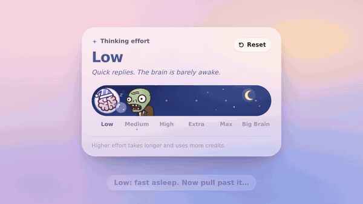
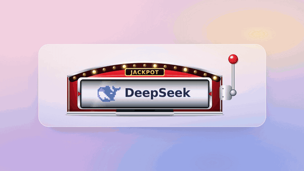
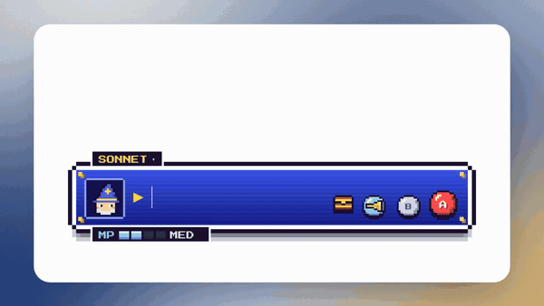
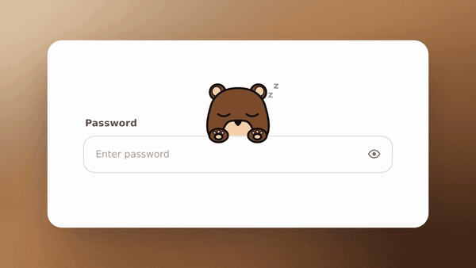
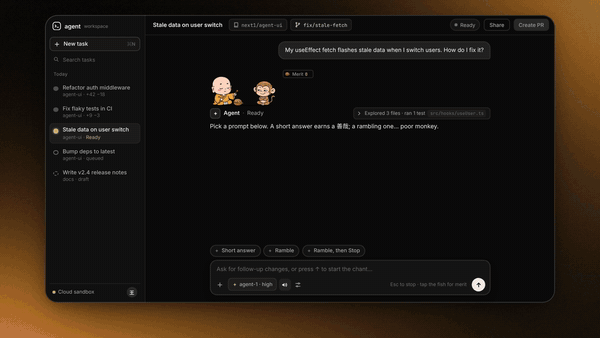
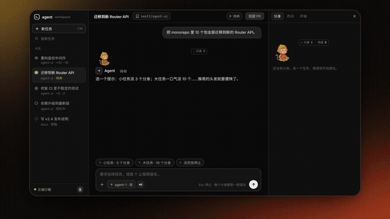

# Creative Components

Playful, illustrated UI components for AI apps. Each one is a real, usable control with a little story inside it.

<table>
<tr>
<td width="50%" valign="top"><a href="./thinking-effort"></a><br><b><a href="./thinking-effort">Thinking Effort</a></b><br><sub>A thinking-effort slider. The knob is a brain and a zombie chases it. Pull it too low and the brain gets eaten.</sub></td>
<td width="50%" valign="top"><a href="./model-slot"></a><br><b><a href="./model-slot">Model Slot</a></b><br><sub>A model picker shaped like a tiny slot machine. Swipe the reel or pull the lever, and Opus and Astra hit a jackpot.</sub></td>
</tr>
<tr>
<td width="50%" valign="top"><a href="./pixel-dialog"></a><br><b><a href="./pixel-dialog">Pixel Dialog</a></b><br><sub>A chat input that's a 16-bit RPG dialogue box. A mage casts your message as FIRE, FIRA or FIRAGA by its length, listens when you talk, and drops loot when you attach a file. Switch models by changing party members and set thinking effort on an MP bar.</sub></td>
<td width="50%" valign="top"><a href="./nosy-password"></a><br><b><a href="./nosy-password">Nosy Password</a></b><br><sub>A password field with a nosy teddy or corgi peeking over it. It watches you type, and when you reveal the password it hides its eyes (the corgi shows you its butt), then sneaks a peek.</sub></td>
</tr>
<tr>
<td width="50%" valign="top"><a href="./chanting-monk"></a><br><b><a href="./chanting-monk">Chanting Monk 唠叨和尚</a></b><br><sub>Streaming-output component: the longer your AI talks, the harder the monk chants. Hit Stop and the monkey stuffs a peach in his mouth.</sub></td>
<td width="50%" valign="top"><a href="./clone-hairs"></a><br><b><a href="./clone-hairs">Clone Hairs 身外身法</a></b><br><sub>Subagents / parallel-runs component: for every subagent the Monkey King plucks a hair and blows, and a tiny clone hops out to work. Spawn too many and he goes bald, then screams at the mirror.</sub></td>
</tr>
</table>

Click a preview to open that component: the code, an offline demo, and the full showcase video with sound.

Every component is a single React 18 file plus one CSS file, with an offline `demo.html` and a showcase video in `media/`.

**No React? Use plain HTML.** Each folder also has a ready-made Web Component file. Add one script tag and write the tag:

```html
<script src="creative-components.js"></script>

<thinking-effort value="1"></thinking-effort>
<model-slot></model-slot>
<pixel-dialog></pixel-dialog>
<nosy-password></nosy-password>
<chanting-monk demo="short" sound="true"></chanting-monk>
<clone-hairs demo="big" sound="true"></clone-hairs>
```

`creative-components.js` has all of them. Each folder's own `<name>.js` has just that one, and `example.html` shows it working. A tiny renderer ([Preact](https://preactjs.com)) is bundled inside, so the page needs nothing else. They're keyboard and screen-reader accessible, SSR-safe and respect `prefers-reduced-motion`.

New components land here as they're made.

Made by [@nextoneforeal](https://x.com/nextoneforeal) · [heynext1.com](https://heynext1.com)

## License

Free for non-commercial use under the [PolyForm Noncommercial License 1.0.0](./LICENSE). Keep the credit line when you share them.

**Commercial use needs permission.** Email [next1foreal@gmail.com](mailto:next1foreal@gmail.com) or DM [@nextoneforeal](https://x.com/nextoneforeal) on X. See [COMMERCIAL.md](./COMMERCIAL.md).
