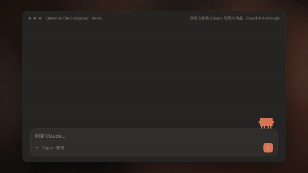

# Clawd on the Composer

A tiny pixel Clawd that lives on the top edge of an AI chat composer and acts out what the agent is doing: it paces while thinking, ticks off a clipboard for `TodoWrite`, reads a book for `Read`, sweeps a magnifier for `Grep`, surfs a wave for `WebSearch`/`WebFetch`, sends out three mini clones for `Task`, types on a laptop for `Edit` and while the reply streams, hauls a box for other tool calls, holds up a sign when it needs permission, runs a taxi meter while tokens stream, falls off the edge on errors, and snores when you say good night. One `<canvas>`, no images, no dependencies; every sound is synthesized 8-bit.

> **Unofficial fan tribute.** Clawd is Anthropic's mascot for Claude Code. This project is not affiliated with or endorsed by Anthropic. The Clawd character © Anthropic and is **not** covered by this repo's license; only the code is.

<p align="center"></p>

[Live demo](./demo.html) · [Minimal example](./example.html) · [Showcase video](./media/showcase.mp4)

## States and gags

| Trigger | What Clawd does |
| --- | --- |
| idle | Sits and blinks, glances at your cursor, and now and then fidgets: looks around, snips its claws, yawns or dances. Before 5 am a little coffee mug appears. |
| hover | Purrs. |
| `typing(len)` | Watches you type. Typing past 200 characters makes it jump ("whoa"); deleting a long draft makes it shrug. |
| `paste(chars)` | Gets buried under a stack of paper (more paper for longer pastes). |
| `send(text)` | Paces back and forth, thinking. The message text also triggers reactions: "thanks / 谢谢" → hearts, "haha / 哈哈" → laughs, an insult → sad, "good night / 晚安" → waves and falls asleep, "good morning / 早安" → yawns awake. |
| `tool(name)` | Acts out the tool by name: `TodoWrite` → ticks off a clipboard, `Read`/`Glob`/`LS` → reads a book (page flips), `WebSearch`/`WebFetch` → surfs a wave across the composer, `Task`/`Agent` → three mini clones run out and merge back, `Grep`/`*Search`/`Find` → sweeps a magnifier, then "!" when found, `Edit`/`Write`/`MultiEdit` → types on a laptop, anything else (`Bash`, `WebFetch`, …) → carries a labelled box (4+ boxes stack up). Calls queue up and play one after another. |
| `ask()` | Holds up a "May I? / 可以吗？" sign. `decide(true)` nods, `decide(false)` shakes its head. |
| `grab()` / `dragTo(x, y)` / `drop()` | Pick-up. Both wrappers wire this to pointer drag on Clawd (click still pets): it dangles with its legs kicking, drops with a thud and walks home. Shake it hard while holding and it lands dizzy. |
| `stream()` | Types on a laptop (soft key clacks, code glyphs float up) and runs a taxi meter (`$`, tokens or % of context, click to cycle) fed by `cost()`. |
| `done()` | Small hop. If the run had 3+ tools and zero errors, it puts on sunglasses and struts instead. |
| `error()` | Falls off the composer, then climbs back up. |
| `stop()` | Stops. Press Esc three times within 2.5 s and it flips over, dizzy. |
| `context(p)` | Gets chubby at 70%, sweats at 85%, round at 95%. |
| `compact()` | Sheds its shell like a crab molting and is slim again. |
| `limit(resetAt)` | Sleeps under a countdown until the usage limit resets. |
| `pet()` / click | Happy wiggle. Pet it five times in a row and it gets annoyed. |
| `welcome()` | Waves. Also fires automatically when you come back to the tab after 20 s or more. |
| asleep | After 60 s idle it dozes off and snores softly (a short burst of breaths, then one breath every ~14 s). |

## Use

```jsx
import ClawdPerch from './clawd-perch/ClawdPerch.jsx';

const clawd = useRef(null);

<div className="composer">
  <ClawdPerch ref={clawd} lang="en" />
  <textarea
    onChange={e => clawd.current.typing(e.target.value.length)}
    onKeyDown={e => e.key === 'Escape' && clawd.current.stop()}
  />
</div>

// wire it to your agent loop
clawd.current.send(prompt);
clawd.current.tool('Bash');
const ok = await clawd.current.ask();   // resolves after decide()
clawd.current.decide(userClickedAllow);
clawd.current.stream();
clawd.current.cost({ usd: 0.42, tokens: 12800, pct: 0.31 });
clawd.current.done();
```

Place it directly above the composer and give it the composer's width. It draws on a transparent canvas, so the composer's top border becomes its floor.

### Props

| Prop | Default | |
| --- | --- | --- |
| `status` | — | Base state: `idle`, `typing`, `thinking`, `streaming`, `ask`, `limit`. Use the methods for one-off gags. |
| `context` | `0` | Context window used, 0–1. Drives the chubby / sweating / round body. |
| `cost` | — | `{ usd, tokens, pct }` for the meter. |
| `size` | `'xs'` | `'xs'` (4 px per art pixel, 96 px tall) or `'lg'` (8 px per art pixel). |
| `lang` | `'zh'` | `'zh'` or `'en'` for the sign, speech and screen-reader text. |
| `mute` | `false` | Turn every sound off. |
| `meterTick` | `false` | Tick sound while the meter runs. |
| `fidgets` | `true` | Idle fidget animations. |
| `fidgetSound` | `false` | Let idle fidgets make sound (silent by default so it never chirps at you unprompted). |
| `snoreSound` | `true` | Snore while asleep. |
| `onStatus` | — | Called with `{ state, label }` whenever the visible state changes. |

All methods in the table above are available on the ref, plus `lookAt(x)`, `hover(bool)`, `fidget(name)` and `nightMode(bool | null)` (force or release the coffee-mug night look).

## Keyboard and accessibility

- Clawd itself is a real `<button>` ("Pet Clawd"), and the meter is a second button that cycles `$ → tokens → %`. Both are reachable with Tab and show a focus ring.
- A polite `aria-live` region announces state changes ("Thinking", "May I?", "Good night"…), so the gags are not visual-only.
- With `prefers-reduced-motion`, Clawd stops pacing and idle fidgeting and stays in its spot; it only animates in response to something you or the agent did.
- The canvas is `aria-hidden`; it never steals focus or blocks clicks on the composer.

## Sound

Every sound is synthesized at runtime with the Web Audio API (no audio files). Audio unlocks on the first click or key press, as browsers require. Levels are balanced: event sounds sit around −25 LUFS, small frequent ones (typing ticks, footsteps) about 12–18 dB quieter, and sleepy sounds (snore, purr) quieter still, so it stays in the background next to your own audio. Use `mute` to silence everything, or `snoreSound={false}` / `fidgetSound` for finer control.

## Plain HTML

```html
<script src="./clawd-perch.js"></script>
<clawd-perch lang="en"></clawd-perch>
<script>
  const c = document.querySelector('clawd-perch');
  c.send('refactor the login flow'); c.tool('Read'); c.done();
</script>
```

Attributes: `status`, `size`, `lang`, `context`, `mute`, `meter-tick`, `fidget-sound`, `no-fidget`, `no-snore`, `manual` (drive `tick(dt)` yourself, for recording).
Methods: the same as the React ref (`setStatus`, `typing`, `send`, `think`, `stream`, `tool`, `ask`, `decide`, `error`, `done`, `stop`, `context`, `compact`, `limit`, `cost`, `thanks`, `pet`, `paste`, `welcome`, `fidget`, `lookAt`, `hover`, `nightMode`). The element wires pointer tracking and tab-return waves by itself.

## Files

| File | |
| --- | --- |
| `clawd-engine.js` | The framework-free engine: drawing, state machine, synthesized sound. |
| `ClawdPerch.jsx` + `clawd-perch.css` | React wrapper. |
| `clawd-perch.js` | Standalone Web Component bundle (`<clawd-perch>`), engine included. |
| `demo.html` | Fake agent chat to play with every state. |
| `example.html` | Minimal web-component wiring. |
| `media/` | Showcase video, poster and preview GIF. |

## Credits

- Clawd character design © Anthropic. Drawn here from scratch as pixel art, as a fan tribute.
- The snore is ported from the pixel buddy on [heynext1.com](https://heynext1.com). All other sounds are original 8-bit synthesis.

Made by [@nextoneforeal](https://x.com/nextoneforeal) · [heynext1.com](https://heynext1.com)

## License

Free for non-commercial use under the [PolyForm Noncommercial License 1.0.0](../LICENSE). Commercial use needs permission: see [COMMERCIAL.md](../COMMERCIAL.md). The Clawd character is not included in this license.
