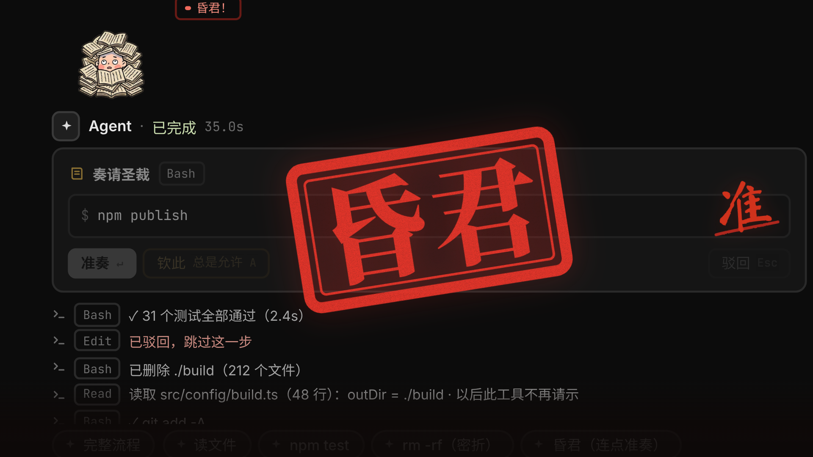

# Your Majesty, Approve? (皇上批奏折)

A permission / approval prompt for AI agents. When your agent wants to run a tool, a chibi court eunuch (小太监) trots in, kneels and holds up a memorial (奏折) with the tool call written on it. You are the emperor. Allow it, deny it, or allow it forever, and he reacts to every decision.

It's a real permission prompt underneath: it shows the tool and the command, fires `onDecision` the moment you decide, and works with keyboard and screen readers.

[](media/showcase.mp4)

▶ [Watch the showcase](media/showcase.mp4) · [Try it live](https://heynext1.com)

## States and gags

- **Waiting**: he trots in, kneels calmly and says 「皇上…」. After 5s he gets nervous. At 11s a waterfall of sweat runs down and his legs shake (「皇上～皇上？」). At 20s he falls asleep with a snot bubble and Zz, snoring softly (「呼噜～」). Hover the prompt and he wakes up. A sealed memorial (see below) never lets him sleep.
- **准奏 / Allow**: a red brush writes 「准」 on the memorial, he kowtows so hard the floor cracks (「谢主隆恩！」), then scurries off.
- **驳回 / Deny**: the memorial slaps him in the face and the card shakes (「哎哟！」), then he slinks away.
- **Three denials in a row**: after the slap he bursts into tears, 「臣冤枉啊～」.
- **钦此 / Always allow**: a gold 玉玺 imperial seal slams down, and he breaks into a golden-jacket disco with sparkles (「奴才领旨！」).
- **密折 / Dangerous command**: `rm -rf`, `sudo`, `DROP TABLE`, `git push --force`, payments and the like arrive as a black-and-red sealed memorial. His hat flies off (「啊！！」). Allow becomes a red **press-and-hold** button (1s, with a fill ring; releasing cancels and a plain click does nothing), and Always allow is disabled.
- **昏君 / The tyrant easter egg**: approve 3 requests in a row, each less than 1.2s after it appeared (so you clearly didn't read them). He flashes a sly gold-ingot grin (「嘿嘿嘿」), gets buried under a pile of memorials (「救命…」), praises you (「皇上英明～」), and a big red 「昏君」 seal stamps across the prompt. Then the counter resets.

After each decision the card collapses into a one-line result row (the decision, the tool and the command), so the thread stays tidy. A new `ask()` during an animation is queued and shown when it ends.

Original art. No art or audio from any film, TV series or game.

## Use

```jsx
import MemorialPrompt from './MemorialPrompt.jsx';
import './memorial.css';

const prompt = useRef(null);

<MemorialPrompt
  ref={prompt}
  request={{ tool: 'Bash', command: 'npm test', summary: 'Run the unit tests' }}
  onDecision={(decision, request) => console.log(decision, request)}  // 'allow' | 'deny' | 'always'
  lang="en" theme="dark" size="xs"
>
  {/* your own "Agent · status" row, rendered between the character and the card */}
  <div className="agent-row">Agent · waiting for approval</div>
</MemorialPrompt>

// or drive it imperatively
prompt.current.ask({ tool: 'Bash', command: 'sudo rm -rf /var/cache' });   // arrives as a 密折
prompt.current.decide('deny');
prompt.current.reset();
prompt.current.state;
```

Layout, top to bottom: the kneeling character, then your header row (children), then the memorial card. No box or background of its own, so it sits inside an agent thread like the rest of the reply.

**Props**

| Prop | Default | |
|---|---|---|
| `request` | | `{ tool, command, summary?, danger? }`. `danger` forces the sealed memorial on or off; when it's not set, the command and tool are matched against a built-in danger pattern. |
| `onDecision(decision, request)` | | Fires the moment you decide: `'allow'`, `'deny'` or `'always'`. |
| `lang` | `"zh"` | `"zh"` (准奏 / 驳回 / 钦此) or `"en"` (Allow / Deny / Always allow). Voice lines are Chinese in both. |
| `theme` | `"dark"` | `"dark"` (thin warm-dark rim on the art) or `"light"` (white sticker edge). |
| `size` | `"xs"` | `"xs"` for a chat thread, `"lg"` (1.8×) for a showcase. |
| `sound` | `true` | Sound effects and voice lines. The first click on the page unlocks audio. |
| `voices` | | `{ v_wait: url, … }` to replace any embedded voice line with your own recording. |
| `autoFocus` | `true` | Focus the card when a request arrives. |
| `showChip` | `true` | The small status chip (Waiting, Asleep, Allowed…). |
| `nervousMs` / `sweatMs` / `sleepMs` | 5000 / 11000 / 20000 | When he gets nervous, sweats and falls asleep. |
| `holdMs` | 1000 | Press-and-hold time on a dangerous command. |
| `fastMs` / `fastCount` | 1200 / 3 | The 昏君 egg: how fast, and how many approvals in a row. |
| `denyCount` | 3 | Denials in a row before he cries. |

Also exported: `isDanger(request)` and `DANGER_RE`.

**Keyboard and accessibility.** Enter = Allow (on a dangerous command, hold Enter for 1s), Esc = Deny, A = Always allow, Tab moves between the buttons. The card is a `role="alertdialog"` labelled by its title and described by the command, and a polite live region announces each request and each decision. With `prefers-reduced-motion` every animation jumps straight to its final state. SSR-safe.

**Sound.** Sound effects (brush swish, kowtow thud, slap, seal stamp, gong, coins) are synthesized at runtime with WebAudio, so there are no SFX files. The voice lines are embedded as MP3 (about 230 KB). One sound per beat: when a voice line carries a beat, that beat's effect stays silent, and each line starts when the previous sound ends. Everything is loudness-matched and runs through a limiter.

## Plain HTML

```html
<script src="memorial-prompt.js"></script>
<memorial-prompt theme="dark" size="xs" lang="en">
  <div slot="header">Agent · waiting for approval</div>
</memorial-prompt>
<script>
  const el = document.querySelector('memorial-prompt');
  el.ask({ tool: 'Bash', command: 'npm test' });
  el.addEventListener('decision', (e) => console.log(e.detail));   // { decision, request }
</script>
```

Attributes: `request` (JSON), `lang`, `theme`, `size`, `sound`, `auto-focus`, `show-chip`, `voices` (JSON), `nervous-ms`, `sweat-ms`, `sleep-ms`, `hold-ms`, `fast-ms`. Methods: `ask()`, `decide()`, `reset()`. Your header row goes in `slot="header"`. `example.html` shows a dark and a light prompt working, and `demo.html` is an offline demo inside a dark agent thread (sound on; click once to unlock audio).

## Files

`MemorialPrompt.jsx` (the component, React 18 or Preact), `memorial.css`, `memorial-sprites.js` (the character art, dark and light), `memorial-glyphs.js` (the 准 / 驳 / 钦此 / 昏君 glyphs as SVG paths, so no webfont is needed), `memorial-sfx.js` (the voice lines), `memorial-prompt.js` (the Web Component, Preact bundled), `demo.html`, `example.html`.

## Credits

**Voice.** All the Chinese voice lines (「皇上…」, 「皇上～皇上？」, 「呼噜～」, 「谢主隆恩！」, 「哎哟！」, 「臣冤枉啊～」, 「奴才领旨！」, 「啊！！」, 「嘿嘿嘿」, 「救命…」, 「皇上英明～」) are by the author.

**Fonts.** The 准 and 驳 brush glyphs are from [Ma Shan Zheng](https://fonts.google.com/specimen/Ma+Shan+Zheng), and the 钦此 and 昏君 seal glyphs from [Noto Serif SC](https://fonts.google.com/noto/specimen/Noto+Serif+SC), both under the SIL Open Font License 1.1, converted to SVG paths.

Made by [@nextoneforeal](https://x.com/nextoneforeal) · [heynext1.com](https://heynext1.com)

## License

Free for non-commercial use under the [PolyForm Noncommercial License 1.0.0](../LICENSE). Commercial use needs permission: see [COMMERCIAL.md](../COMMERCIAL.md).
